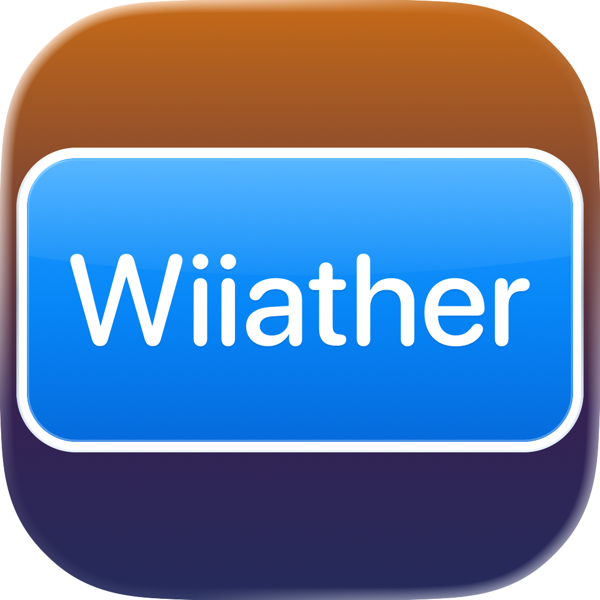

<!-- SPDX-FileCopyrightText: 2026 Nick Wolff <nick@wolff.tech> -->
<!-- SPDX-License-Identifier: GPL-3.0-or-later -->

<p align="center">
  
</p>

<h1 align="center">Wiiather</h1>

<p align="center">
  A WeatherStar 4000 for the Nintendo Wii.
</p>

Wiiather is a homebrew port of [ws4kp](https://github.com/netbymatt/ws4kp)
that fetches live National Weather Service (NWS) data over HTTPS and shows it
in the style of The Weather Channel's 1990s local forecast.

> [!WARNING]
> Do not rely on Wiiather in life-threatening weather situations. Its data can
> be incomplete or out of date. Use NOAA Weather Radio or official NWS
> channels for alerts.

## Features

- Current conditions, latest observations, hourly, travel, regional, local and
  extended forecasts, an hourly graph, an almanac, the Storm Prediction
  Center's severe weather outlook and the local radar, rotating like the
  original
- A scrolling bottom bar with conditions and active NWS hazard alerts
- ZIP code lookup, with a suggestion based on the Wii's public IP address
- Optional background music from your own MP3s
- Signed certificate authority updates, so HTTPS keeps working after release

US locations only, since all data comes from the NWS.

## Install

Wiiather requires a Wii with the
[Homebrew Channel](https://wiibrew.org/wiki/Homebrew_Channel) and a working
internet connection set up in the Wii's system settings.

1. Download `Wiiather-X.Y.Z.zip` from
   [GitHub Releases](https://github.com/WolffTech/Wiiather/releases), or
   [build from source](#build-from-source).
2. Extract the zip and copy its `apps/` folder to the root of the SD card.
3. Launch Wiiather from the Homebrew Channel.

### Music

To add background music, copy `.mp3` files to `apps/wiiather/music/` on the
SD card. They play in random order, and the Wii Remote's A button turns music
on and off. ws4kp's royalty-free tracks in
[`server/music/default`](https://github.com/netbymatt/ws4kp/tree/main/server/music/default)
work well.

## Getting started

On first launch, Wiiather asks for a ZIP code. It suggests one based on the
Wii's public IP address, looked up with [ipinfo.io](https://ipinfo.io), which
sees that address. Change digits with the D-pad's up and down, move between
them with left and right, and press A to save. Press + at any time to pick a
new location, and B to back out.

The location is saved in `apps/wiiather/settings.ini`. To use exact
coordinates instead, for example for a place without a ZIP code, edit the
file:

```ini
lat=38.8951
lon=-77.0364
```

### Certificate updates

Wiiather checks each server's HTTPS certificate against a bundle of trusted
certificate authorities (CAs) built into the app. Authorities change over
time, so once a day Wiiather also checks this repository's
[`ca-bundle`](https://github.com/WolffTech/Wiiather/tree/ca-bundle) branch on
raw.githubusercontent.com for a newer bundle. It installs one only if the
project's signature verifies and the bundle is newer than the one it has,
and saves it to `apps/wiiather/cacert.pem` for the next launch.

If a Wii sits unused long enough that the weather servers move to an
authority its bundle doesn't know, Wiiather can no longer verify them. It
then fetches the signed bundle without checking GitHub's certificate, since
the signature alone proves where the bundle came from, and resumes once a
newer bundle installs. Until then it shows "Wiiather may need updating."

> [!IMPORTANT]
> Certificate updates depend on this project continuing to publish signed
> bundles from a public GitHub repository. If publishing stops, the repository
> goes private or the signing key is lost, Wiiather will eventually be unable
> to verify the weather servers, and only a new release will fix it.
> Certificate checks also fail if the Wii's clock is wrong, so keep its date
> and time set correctly.

## Build from source

Install [devkitPro](https://devkitpro.org/wiki/Getting_Started) with `wii-dev`
and the PowerPC portlibs for jansson, FreeType, libpng, libjpeg-turbo, bzip2,
brotli and zlib, then run:

```sh
git clone https://github.com/WolffTech/Wiiather.git
cd Wiiather
scripts/build-deps.sh
make dist
```

`scripts/build-deps.sh` builds GRRLIB and a Wii-configured mbedTLS. `make dist`
writes the Homebrew Channel app to `dist/apps/wiiather/`.

For development:

```sh
make        # wiiather.dol
make test   # host-side unit tests (needs a native C compiler)
make run    # send to a Wii running the Homebrew Channel with wiiload
```

Dolphin can also run `wiiather.dol` directly.

To publish a release, create a GitHub release with a new `vX.Y.Z` tag. The
release workflow builds it with `make clean dist VERSION=X.Y.Z` and attaches
the Homebrew Channel zip, the libogc source (for libmad's GPL) and
`SHA256SUMS`. Local builds report their version as `dev`.

Forks that distribute their own builds should replace `CA_BASE_URL` and the
public key in `source/net/ca_update.c` with their own bundle location and
signing key. Otherwise, those builds will depend on this repository's
certificate bundles.

## Disclaimer

The WeatherSTAR 4000 name and design belong to The Weather Channel. Wiiather
is a free, non-commercial fan project and is not affiliated with The Weather
Channel, the NWS or Nintendo.

## License

Wiiather is free software licensed under the
[GNU General Public License, version 3 or later](LICENSE). Third-party
attributions are listed in [THIRD_PARTY_NOTICES.md](THIRD_PARTY_NOTICES.md).
